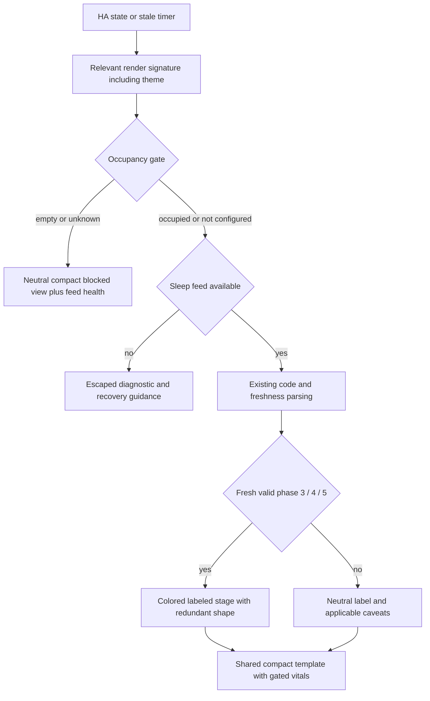
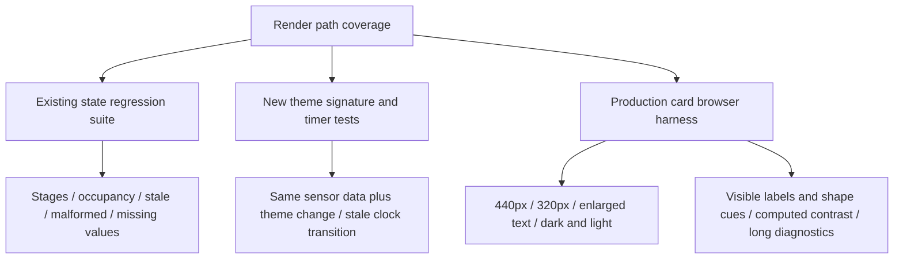
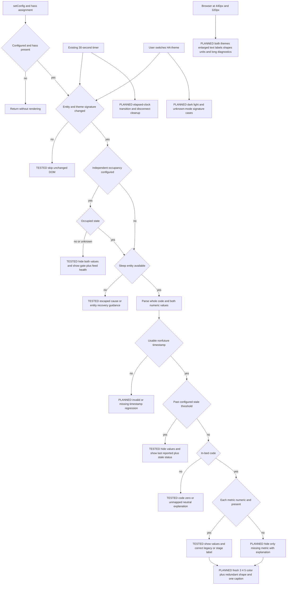

# Compact SleepRadar card implementation plan

Date: 2026-10-14
Repository: florianhorner/ha-fp2-sleep
Base: bf3cf1b6012609d71244de953a429223a1f51b95 (main)
Work branch: codex/compact-phase-card-20261014
Review target and report destination: docs/compact-card-plan.md

## Goal and approved design

Implement the compact card approved in this conversation on 2026-10-14. The
final direction supersedes the earlier tinted-header exploration: neutral
surfaces, crisp phase accents, restrained typography, and no washed-out fills.
The user explicitly authorized planning, plan-eng-review, implementation and
routine engineering decisions on a new separate branch. Main and Home Assistant
deployment are outside the authorized implementation destination.

The approved preview is reference material, not production architecture. It
wraps the current card with subclasses and DOM transformations. Production will
render the layout directly without those wrappers.

Acceptance criteria:

- Phase first, heart rate and breathing second, provenance and caveats last.
- A compact header, two metric columns, 8px card radius, 2px phase rail, 22px
  phase heading, 32px tabular metric values, readable 12–13px supporting text.
- Fresh REM, Light sleep and Deep sleep have distinct accents and redundant
  diamond, hollow-circle and filled-circle markers. Literal phase names remain.
- Stale, unavailable, unknown and occupancy-blocked states are visually neutral.
- Preserve the sensor's best-guess qualification beside valid stage labels.
- Remove repeated healthy-state narrative and duplicated Live now labels.
  Keep all applicable safety, missing-value and recovery explanations.
- Respect Home Assistant light/dark themes, including theme switches with no
  sensor value changes. Preserve inherited surface/text theme variables and
  allow documented SleepRadar phase-ink overrides for custom themes.
- No new runtime dependencies, network calls, animation, charts or fake history.
- At 320px width, long state/diagnostic text wraps without hiding values/units.
- Default light/dark phase text and markers meet AA contrast. Color is never
  the sole way to identify a phase. Custom themes remain user-controlled and
  require their own contrast verification.

## What already exists

- `card/sleepradar-card.js`: zero-dependency custom element, escaping, strict
  whole-string integer parsing, numeric-vital parsing, freshness checks,
  independent occupancy gate, connection diagnostic cause, render signature,
  and 30-second stale recheck with lifecycle cleanup. Reuse these decisions.
- `tests/sleepradar-card.test.js`: Node built-in assert/vm harness, fake clock,
  extensive stale, malformed-code, occupancy and diagnostic cases. Extend it.
  Individual missing/nonnumeric vitals, invalid/missing timestamps, theme
  changes and timer lifecycle need new explicit regression cases.
- `DESIGN.md`: telemetry-first voice, categorical colors, 8px radius, system
  typography, sensor-reported versus estimated-stage distinction.
- `CONTRIBUTING.md` and CI: a shared validation block with Python 3.11+, Node,
  YAML validation and repository/GIF validators. Run the required shared gates.
- The approved interactive preview supplies the layout and color reference.

## NOT in scope

- MQTT, Aqara polling, freshness thresholds or entity interpretation changes.
  In particular, per-vital timestamp policy remains unchanged.
- New config options, backend integrations, live HA credentials or deployment.
- Dashboard-wide redesign, history charts, animation or marketing assets.
- Dependency upgrades, release/version changes, unrelated cleanup or fixes.
- Merging to main. The deliverable is the separate implementation branch.

## Implementation approach

1. Preserve all state/occupancy/freshness decisions and early-return ordering.
   Derive presentation phase from the already parsed code and `isFresh` only
   after the occupancy gate. Only codes 3/4/5 receive a phase accent; never
   infer freshness or occupancy again in presentation code.
2. Render a shared compact readout template from the normal and occupancy-
   blocked paths. A small internal renderer receives already-computed labels,
   displayed values, statuses, freshness, timestamp, badge, footer and phase
   category. Escape all dynamic text exactly once at the template boundary.
   Missing-feed diagnostics keep their dedicated empty-state template.
3. Remove the duplicated `describeNow` narrative once no callers remain.
   Shorten the footer only for fresh valid stage codes to Sensor-reported
   vitals; retain the estimate caption. Leave legacy Awake, unverified codes,
   not-measuring, stale and fault caveats intact. Suppress only literal healthy
   Live now metric statuses; preserve No value reported and all fault statuses.
4. Render heading and caption as separate semantic elements. Mark the shape
   decorative (`aria-hidden`). Group labeled metric values; no simulated
   interaction, fake update animation or extra controls in the production card.
5. Add scoped CSS for the approved compact layout. Use inherited HA surface,
   foreground and divider variables, with sensible standalone fallbacks.
   Expose `--sleepradar-deep-color`, `--sleepradar-light-color` and
   `--sleepradar-rem-color` as optional phase-ink overrides.
6. Use the Home Assistant theme mode (`hass.themes.darkMode`) for default phase
   inks. Add the normalized mode to the render signature so unchanged sensor
   objects cannot pin the old palette. If mode is missing, use inherited
   primary text for the phase ink instead of guessing from OS preference.
   Apply theme handling to diagnostics and blocked paths as well.
7. Use the existing unit harness for state regressions and a small checked-in
   `proof/compact-card-preview.html` that loads the actual production JS with
   synthetic data for browser QA. The harness includes phase/fault selection,
   theme and 320px controls, and keeps synthetic live timestamps fresh. It
   contains no credentials, API calls or copied production renderer.
8. Document the new compact presentation and theme overrides in `DESIGN.md`
   and the existing README card section. Save plan and review in this file.

Expected files: card/sleepradar-card.js, tests/sleepradar-card.test.js,
DESIGN.md, README.md, proof/compact-card-preview.html, docs/compact-card-plan.md.
Six files; no new classes, services or dependencies.

## State and rendering flow



## Test plan

Use `node tests/sleepradar-card.test.js`; extend the existing fake clock and
interval harness only as needed. Keep semantic assertions, replace only
assertions for deliberately removed prose/eyebrow/duplicate Live now labels.

| Contract | Existing coverage | Required proof for this change |
|---|---|---|
| Fresh REM / Light / Deep | Values, captions and phase labels | Correct category/shape, one estimate caption, no duplicated live prose |
| Empty or unavailable occupancy | Retained values hidden; independent gate | Neutral compact view, same explanation, no colored stage |
| Occupied code 0; codes 1/2 | In bed / stage unknown; compatibility caveats | Preserve labels, gating and caveats in compact layout |
| Stale / invalid / future timestamp | Stale and future-date cases exist; invalid/missing timestamp cases must be added | Hidden values, neutral accent, last-reported caption; timer-driven transition without hass updates |
| Unknown/malformed sleep code | Unknown label and hidden values | No phase accent or false fresh-stage label |
| One missing/non-numeric vital | New coverage required; parser exists | Only affected metric hidden; preserve per-metric explanation while healthy status is suppressed |
| Missing sleep sensor / connection failure | Diagnostics and escaping | Compact empty-state padding, long text wrap and escaped cause |
| Feed fault while occupancy blocks | Feed-health caveat alongside gate | Same caveat and neutral presentation |
| Theme switch with identical states | New coverage required | Dark→light and light→dark render; unknown mode follows inherited text |
| Signature and lifecycle | Signature cases exist; timer probe needed | Unchanged state/theme skips rerender; disconnect clears stale timer |
| Responsive, theme and non-color cues | Node harness cannot measure CSS | Real browser at 440px/320px; both themes; labeled shapes, units, long errors |



No LLM/prompt changes or eval suite apply. Full HA integration is unavailable
without Supervisor, MQTT and credentials; report this limitation rather than
claiming a live-device test. Browser fixtures use only synthetic data.

## Failure modes and acceptance

| Failure | Prevention / test | User-visible behavior |
|---|---|---|
| Retained measurements look live in an empty bed | Preserve gate ordering; existing/new regressions | Em dashes plus occupancy explanation |
| Stale phase keeps a colorful current-state cue | Category derived from existing freshness; timer test | Neutral last-reported phase and stale notice |
| Duplicate presentation parser accepts malformed input | Reuse existing parsed code; malformed regression | Unknown phase and hidden vitals |
| Theme changes but colors do not | Theme in render signature; both directions tested | Readable phase ink immediately |
| Long labels or errors clip at 320px | Wrap heading/metadata and diagnostic text; browser QA | Full explanation, no lost units |
| Removing summary loses a critical caveat | Preserve status/footer semantics and assertions | Missing and fault states remain explicit |
| Diagnostic text injects markup | Preserve escapeHtml boundary; regression suite | Text is displayed, not executed |

## Execution order and verification

1. Write this plan on the isolated branch; complete plan-eng-review and save
   its decision record and report before product edits.
2. Implement direct rendering and theme signature together; add corresponding
   state/theme/timer regressions using the existing test harness.
3. Add the small production preview harness and update design/usage docs.
4. Run the CONTRIBUTING shared validation block through Python 3.11+ and Node;
   inspect desktop/mobile, themes, and failure states in the browser.
5. Review the final diff for scope, commit intentional files on this branch,
   and publish this separate branch if GitHub access is available. No merge or
   deployment. Hand off branch, plan, validation evidence and limitations.

Sequential implementation, no parallelization opportunity in the shared card
renderer. Independent reviewers may inspect the plan/diff without modifying it.
No separate worktrees or competing implementations are necessary.

## Engineering review

Completed native plan review on 2026-10-14 against base `bf3cf1b`. Product
implementation had not started at review time. The implementation branch and
report target were supplied explicitly by the parent task. The skill preamble
confirmed `SESSION_KIND: spawned`; no user question or consent was fabricated.

Reviewed the invoked Codex skill and the referenced `sections/review-sections.md`.
Their outside-provider instructions differ by host. The invoked Codex entrypoint
correctly selects Claude Code; no nested Codex review was started. Existing
config was preserved in repository-local `.gstack` state: telemetry off,
outside reviews enabled, artifact sync off, cross-project learnings enabled.
No global settings were changed. Brain lookup returned “missing: brain
unreachable; no cache available”; the user conversation, design specification
and checked-in files supply the required context. Prior-learning search yielded
no results. The existing repository history includes the occupancy gate and
connection-diagnostic fixes; no path-specific revert was found. The new proof
page and this plan have no prior history.

### Scope Challenge

No issues found. Scope accepted as-is: six files, one existing custom element,
zero new classes/services/dependencies. The complexity gate does not apply.

- **[Layer 1] Reuse:** retain `displayPhase`, `numericStateOrNull`,
  `parseTimestampMs`, `describeVitalStatus`, `describeFooter`, the occupancy
  gate, diagnostic resolver and signature/timer machinery. Change their output
  composition only where the approved compact design requires it.
- **[Layer 3] Platform:** use CSS variables and a small shared template in the
  existing file. The prototype's subclass/DOM-transformation stack is unsuitable
  production structure and is already excluded by the plan.
- **Search check:** no new architectural, infrastructure or concurrency pattern
  is proposed. Aside is absent. The host search verified the proposed theme
  interface against Home Assistant's own frontend source:
  [Themes.darkMode](https://github.com/home-assistant/frontend/blob/dev/src/data/ws-themes.ts).
  It represents the effective boolean mode, including when the user selected auto.
- **TODO cross-reference:** existing source-timestamp accuracy and occupancy/code
  interpretation follow-ups remain outside this presentation change. The plan
  changes none of those policies. No TODO blocks the compact rendering work.
- **Distribution:** the same unbundled `card/sleepradar-card.js` resource ships by
  the existing installation mechanism. No new build, package or release lane is
  needed. Publishing a release and updating Home Assistant remain out of scope.

### Architecture review

No issues found. The normal and blocked paths currently duplicate almost the
same markup (`card/sleepradar-card.js:505` and `:637`). A shared presentation
method is a small, justified extraction. Passing already-gated values prevents
that extraction from creating a second occupancy/freshness policy. The dedicated
missing-data diagnostic path remains separate and continues escaping its cause.

The render signature at `card/sleepradar-card.js:390` tracks watched entities and
connection cause. Including the normalized theme mode avoids a stale palette
when only the theme changes. CSS variables keep custom-theme inheritance live
without reading computed style or adding observers. A missing theme mode safely
uses inherited foreground ink.

The only stateful resource remains the existing 30-second interval. No new
network boundary, credential access, storage, database or shared service exists.
Each failure path has a visible fallback in the plan's failure table. The blast
radius is the custom card's shadow DOM; rollback is restoring that one resource.
The source flow is simple enough that the existing occupancy and staleness
comments plus this plan's diagrams suffice; no extra inline diagram is required.

### Code quality review

No issues found. Keep the shared method internal to `SleepradarCard`; do not add
a view-model framework, template library or inheritance hierarchy. Use fixed
phase keys for CSS classes, never untrusted sensor strings. Dynamic text should
be escaped once at the final template boundary; preserved helpers should return
plain text. Semantic heading/caption separation and decorative shape markers
fit the approved accessible design.

Deleting `describeNow` is safe only after checking there are no callers. Its
explanatory content is already represented by the existing status/footer paths;
the test suite must retain those contracts while replacing assertions for the
intentionally removed duplicate prose. Existing no-color warning text and all
recovery guidance stay readable. No stale code diagram was found in touched files.

### Test review

The framework is Node built-in `assert/strict` plus `vm`, confirmed by
`tests/sleepradar-card.test.js:1–4` and the repository instructions. No install or
new testing dependency is required. The current test command completed with
exit 0 on the unmodified production code. This proves the baseline suite only.

The following map joins execution branches to user-visible results. TESTED means
existing assertions were read and the baseline suite passed. PLANNED means
required implementation proof, not a completed test. This is a branch-family
map, not instrumented line coverage.



| Branch family / user flow | Current evidence | Required acceptance |
|---|---|---|
| Valid phase 3/4/5, gated and ungated | TESTED, behavior + caveats; stage loop near test line 943 | Labels and values preserved; exactly one estimate caption; expected shape/category; no healthy `Live now` duplication |
| Empty/unknown gate and recovery | TESTED, edge and error cases including ghost fixture | No stage/metric leakage anywhere in markup; neutral cues; recovery restores values |
| Occupied code 0 and codes 1/2; legacy mode | TESTED, behavior + compatibility caveats | Same labels, gating and warning provenance; no fresh-stage accent |
| Unmapped/malformed code | TESTED with `9`, `3-bad`, `-1` | Neutral unknown label; both values hidden |
| Stale and future-date feed | TESTED, both gate modes | Neutral last-reported stage; both values hidden; stale/unknown freshness wording |
| Missing/invalid timestamp | PLANNED; not previously covered explicitly | `undefined`, `null`, `0`, empty string and invalid date: no values, no fresh phase accent |
| Independently missing/nonnumeric vital | PLANNED; not previously covered explicitly | Missing object, unavailable, None and nonnumeric text for either metric: dash and `No value reported` only for affected metric |
| Diagnostic absent/off/on/causeless/override | TESTED, edge and error cases | Same recovery guidance; escaped HTML-like cause in empty and blocked views |
| Entity, gate or diagnostic-only update | TESTED, same-state guard and recovery | Relevant change renders; identical signature skips DOM work |
| Theme-only assignment | PLANNED | Both mode directions render with identical entities; absent mode inherits foreground; diagnostic and blocked paths also remain legible |
| Clock passes stale boundary without hass update | PLANNED | Invoke captured interval after advancing fake clock beyond 3× poll interval; vitals disappear, phase becomes neutral |
| Disconnect/reconnect | PLANNED | Disconnect clears captured interval; reconnect restores exactly the needed timer |
| Read in narrow layout or enlarged text | PLANNED browser proof | 320px/440px, dark/light, 200% text: visible labels, uncut units, wrapping fault/cause text, phase text and shape contrast verified |

**F1 [P2] (confidence: 10/10), native reviewer:** the original test inventory
incorrectly described missing/nonnumeric-vital and invalid/missing-timestamp
behavior as existing coverage. Original `docs/compact-card-plan.md:135` said
“Only affected metric hidden” under Existing coverage, while line 133 grouped
“Stale / invalid / future timestamp” under existing hidden-value proof. The
concrete harness has a fixed `MockDate.now()` (`tests/sleepradar-card.test.js:9–12`),
no-op interval stubs (`:26`, `:33–35`), and no explicit individual missing-vital
or invalid/missing-timestamp cases. The runtime guards exist at
`card/sleepradar-card.js:233–246`; missing proof is not an observed runtime bug.

Disposition: factual inventory corrected, required proof mapped to T1 under the
already-approved contract. No new behavior or optional verification project was
added. Theme, timer, new phase styling and browser proof were already correctly
identified as future work. One test-inventory issue; zero additional architectural
or runtime remedies. All assertions above are necessary proof of approved
behavior, so no repeated permission request is needed.

No LLM calls, prompts or evals are touched. Node tests cover this single-element
state logic; the production script in a browser is the appropriate integration
proof for shadow DOM, CSS inheritance, shape visibility and layout. Full
Supervisor/MQTT/Aqara testing is not claimed.

### Performance review

No issues found. Entity lookup, timestamp parsing and phase selection stay
constant-time. The card renders a small fixed DOM tree. The existing signature
continues to skip unrelated HA updates, and the new theme field adds negligible
work. No polling loop, history data, layout measurement, observer, animation or
new network request is introduced. Lifecycle proof prevents timer leakage; a
benchmark suite would not answer a concrete remaining risk for this change.

### Outside Voice

Running the outside voice is the skill's standard step. The existing
`codex_reviews: enabled` preference was preserved. Disable with
`gstack-config set codex_reviews disabled` only if the user later requests it.

Preflight found the configured Claude Code executable. The read-only CLI used
`--access none --timeout-ms 300000` and a private prompt containing this plan,
source and native review context. Its completed invocation returned:

```tool-output
{"status":"unavailable","provider":"claude-code","result":"","error":{"code":"authentication","message":"Claude Code authentication failed. Run claude interactively in this execution context to authenticate."},"session_id":"335d9e94-668f-42eb-8b65-e08201ecc687","usage":{"output_tokens_details":{"thinking_tokens":0},"input_tokens":0,"cache_creation_input_tokens":0,"cache_read_input_tokens":0,"output_tokens":0,"server_tool_use":{"web_search_requests":0,"web_fetch_requests":0},"service_tier":"standard","cache_creation":{"ephemeral_1h_input_tokens":0,"ephemeral_5m_input_tokens":0},"inference_geo":"","iterations":[],"speed":"standard","fallback_credit":null},"modelUsage":{},"exit_code":1}
Claude Code outside review unavailable: execution failed; missing coverage.
```

No reviewer text or finding was returned, and no model identity was reported.
The exact native fallback requires an Agent with declared Plan subtype plus
TaskOutput and TaskStop; those APIs are not exposed here. No substitute agent
was counted as an outside review. Outside coverage is unavailable, nonblocking
for implementation, and recorded accurately in the local review log. Repair
requires authenticating Claude Code in this execution context. The first command
was automatically rejected because its cleanup used recursive `rm`; it was
safely retried without that cleanup, and no approval override was requested.

### Failure-mode accounting

Every new path in the diagram has an implementation test or explicit browser
check above. Theme drift, missing measurements and clipping would otherwise be
silent; their planned tests make them release acceptance items. Invalid data
continues to produce visible dashes/caveats, and injected diagnostic text stays
escaped. There are **0 critical gaps without handling and planned proof**.

### TODO disposition

No new TODO proposed. The existing freshness-source, interpretation and broader
integration TODOs remain as already documented. Expanding this branch to those
policies would violate the approved presentation scope.

## Decision ledger

### R1: Preserve the approved card behavior and prove the compact rendering

Plan baseline: approved compact design at user message “approved” (2026-10-14
04:22 Europe/Berlin), followed by explicit instruction at 04:32:45 to write a
plan, run this review, then implement on a new separate branch and “do your
thing there”. The later task explicitly authorizes routine engineering choices.

Runtime evidence: the source implements the gate, parsing, stale suppression,
compatibility caveats and diagnostic escaping described above. Baseline Node
suite passes; it does not yet prove the proposed palette/layout or all newly
listed missing-data cases.

State: approved.
Actual answer: exact prior user authorization cited above; no synthetic option
answer or preference change.
Accepted scope: six planned files, direct compact renderer, theme-aware phase
inks and shape cues, and necessary state/theme/timer/browser regressions. Preserve
existing entity interpretation and freshness policy. Correct the factual test
inventory and make the already-required proof concrete. Product implementation
occurs only after this review, on `codex/compact-phase-card-20261014`.
History: earlier tinted-header direction was superseded by the approved neutral
surface/crisp-accent design before this plan. No review-stage reversal.

### N1: Continue to the implementation already requested

State: approved.
Actual answer: user's same 04:32:45 instruction explicitly orders implementation
after review. No further design/CEO review or navigation question is needed to
repeat that authorization. Optional reviews were not misrepresented as complete.
Accepted scope: follow the existing execution order; no merge or HA deployment.
History: none.

Approval readiness: PASS for R1 and N1 against the actual answer references.
The test correction changes no policy and raises no unresolved choice.

## QA Test Plan artifact status

The required legacy discovery path is outside writable roots:
`~/.gstack/projects/florianhorner-ha-fp2-sleep/`.
The following auxiliary artifact is **not persisted at its discovery path**.
It is presented completely here for handoff; this does not claim `/qa`
auto-discovery. No attempt was made to write the forbidden path.

```markdown
# Test Plan
Generated by /plan-eng-review on 2026-10-14
Branch: codex-compact-phase-card-20261014
Repo: florianhorner/ha-fp2-sleep

## Affected Pages/Routes
- proof/compact-card-preview.html: actual custom-card script with synthetic states.
- Home Assistant custom:sleepradar-card: eventual integration surface, not deployed here.

## Key Interactions to Verify
- Select REM, Light and Deep: explicit label, distinct shape, sharp phase ink.
- Switch light/dark while entity data remains unchanged: palette changes immediately.
- Read at 440px and 320px, plus 200% text: labels and units remain complete.
- Let fake clock pass stale threshold without a hass update: hide vitals and neutralize phase.
- Disconnect and reconnect the element: timer is cleaned up and restored.

## Edge Cases
- Empty, missing, unavailable and nonmatching occupancy state: no retained values or stage leak.
- Occupied code 0 and unverified codes 1/2: preserve existing caveats and labels.
- Unknown/malformed code, stale, future, missing and invalid timestamps: neutral safe output.
- One missing/nonnumeric vital: only that metric is hidden and explained.
- Missing sleep feed or long HTML-like connection cause: escaped readable recovery text.
- Missing theme mode and custom ink override: inherited theme behavior stays readable.

## Critical Paths
- Empty-bed retained REM/deep readings must never appear as current stage or vitals.
- Fault/stale metadata must survive removal of duplicate narrative.
- Both default themes must retain AA text contrast and readable non-color phase cues.

## Pending Decisions
- None.
```

## Implementation Tasks

Synthesized from this review's finding. Baseline implementation steps remain in
Execution order; this section lists only review-derived work.

- [x] **T1 (P2, human: ~45min / CC: ~5min)**: card regression tests: add explicit
  individual missing/nonnumeric-vital and invalid/missing-timestamp cases.
  - Surfaced by: Test review F1, inaccurate existing-coverage inventory.
  - Files: `tests/sleepradar-card.test.js`.
  - Verify: `node tests/sleepradar-card.test.js`; independently omit each metric
    or use unavailable/None/nonnumeric values, and pass missing/null/zero/empty/
    invalid timestamps. Assert the specific dashes, surviving metric, caveats,
    neutral phase cues and absence of leaked retained values.

No new tasks from Scope Challenge, Architecture, Code Quality or Performance.
Effort assumes extending the existing VM harness; no framework setup.

The legacy `/autoplan` JSONL discovery path is also outside writable roots, so
the complete aggregation artifact is **not persisted at its discovery path**:

```jsonl
{"phase":"eng-review","run_id":"compact-card-20261014","branch":"codex/compact-phase-card-20261014","commit":"bf3cf1b6012609d71244de953a429223a1f51b95","id":"T1","priority":"P2","component":"card regression tests","files":["tests/sleepradar-card.test.js"],"effort_human":"~45min","effort_cc":"~5min","title":"Cover independently missing vitals and invalid or missing timestamps","source_finding":"Test review F1: inventory overstates existing missing-data proof"}
```

## Completion summary

- Step 0: Scope Challenge: scope accepted as-is.
- Architecture Review: 0 issues found.
- Code Quality Review: 0 issues found.
- Test Review: coverage diagram produced; 1 test-inventory issue identified and
  required proof mapped to T1. Existing planned theme/timer/browser cases remain.
- Performance Review: 0 issues found.
- NOT in scope and What already exists: written.
- TODOS.md updates: 0 items proposed.
- Failure modes: 0 critical gaps flagged.
- Unresolved decisions: 0 in this review.
- Outside voice: Claude Code unavailable due to authentication; no supported
  native fallback. No outside-review or cross-model agreement credit.
- Parallelization: 1 lane, 0 parallel / 1 sequential. Sequential implementation,
  no parallelization opportunity in the shared card module.
- Lake Score: N/A, no new coverage choice requiring a user decision.
- No durable learnings this session beyond the saved test-inventory correction.

Review status is `issues_open` because the skill counts all findings, including
ones mapped into approved implementation work. This is a plan-stage finding;
implementation may proceed. Shipping needs the mapped tests and an updated
engineering review. No implementation or live-device verification is claimed.

## Suppressed findings

None. No speculative runtime regression was promoted into a finding.

## Implementation and final engineering verification

Completed on 2026-10-14 on the planned separate branch. The card now renders
the compact view directly, shares its normal/blocked template, preserves the
existing safety decisions, and responds to theme-only changes. The production
preview loads that same script with synthetic data.

T1 is complete: 20 independently missing/nonnumeric-vital cases and 10 missing
or invalid-timestamp cases now pass across the two occupancy configurations.
The suite also covers phase categories, neutral states, theme-only rerenders,
unknown theme mode, stale-clock transitions and timer disconnect/reconnect.
Existing gate, retained-value, compatibility and diagnostic protections remain.

An independent final source/test diff review found no actionable regression.
Root reviewed the renderer, escaping boundary, test changes and documentation.
This is implementation review, not a replacement for the unavailable outside
provider's plan review. F1's required proof is satisfied; no open code finding.

### Browser proof

Inspected the actual production card at 440px and 320px, in light/dark modes
and with 200% text. Phase names, geometric cues, captions, metrics and units
remain readable. Stale, missing-value, unknown-stage, unknown-occupancy and
connection-failure fixtures preserve their warnings and hide gated values.
Long HTML-like diagnostic text is visibly escaped and wraps.

A measured 2px Breathing-label overflow inside its column at 320px/200% was
resolved by reducing the marker gap from 7px to 5px. The follow-up measured no
overflowing card descendants. Default phase contrast was measured from the
browser's computed colors, not inferred from CSS selectors:

| Phase | White surface | Night surface `#1b1c1e` |
| --- | --- | --- |
| Deep | 6.05:1 | 8.75:1 |
| Light | 4.95:1 | 9.33:1 |
| REM | 5.91:1 | 10.77:1 |

The markers are respectively filled circle, hollow circle and diamond; literal
labels carry their meaning independently of color. These are default-palette
and browser checks, not a blanket accessibility certification or screen-reader
test. Custom theme overrides require their own contrast checks.

### Required validation and bounded scope adjustment

The complete CONTRIBUTING shared block passed using Python 3.11.15, matching
installed CI dependency versions and Node: whitespace, Python compilation,
YAML lint, repository validation and self-test, all seven CLI tests, GIF source
validation/self-test, builder self-test, binary baseline, card tests and shell
syntax. The final CSS adjustment was followed by card tests and browser proof.

One directly required documentation dependency expanded the original six-file
scope to seven. GIF source validation caught a broad historical README citation
in `videos/sleepradar-last-night-view/BRIEF.md` that included the old live-card
stale-badge wording. After reading the video policies and checking the claim,
the redundant README citation was removed and its checked date/note refreshed.
The four remaining canonical evidence slices still match the pinned main-branch
baseline and support the complete dashboard claim. No validator was weakened;
the GIF claim, composition, delivered binaries and hashes are unchanged. Source
validation then passed, and the binary baseline remains unchanged.

Local validation limits: no live HA Supervisor/MQTT/Aqara deployment or credentials
were used. The Docker daemon is unavailable. The installed Gitleaks is 8.30.1,
not the required 8.30.0 pin, and pip-audit is absent from the Python 3.11 venv;
the separate CI security/build lanes remain authoritative for those checks.
Claude Code outside plan review remains unavailable because of authentication.

## GSTACK REVIEW REPORT

| Review | Trigger | Why | Runs | Status | Findings |
|--------|---------|-----|------|--------|----------|
| CEO Review | `/plan-ceo-review` | Scope & strategy | 0 | Not run | No new product direction |
| Outside Review | Claude Code via `/plan-eng-review` | Independent 2nd opinion | 1 | Unavailable | Authentication failure; no supported native fallback |
| Eng Review | `/plan-eng-review` plus final implementation diff review | Architecture & tests (required) | 1 plan + final diff | CLEAR AFTER IMPLEMENTATION | F1 mapped to T1 and verified complete; 0 open code findings |
| Design Review | `/plan-design-review` | UI/UX gaps | 0 | Not run | User-approved design; no formal gstack design review claimed |
| DX Review | `/plan-devex-review` | Developer experience gaps | 0 | Not run | No new installation or developer surface |

**OUTSIDE COVERAGE:** host Codex, provider Claude Code, phase plan-review,
unavailable. The CLI returned authentication failure and no findings.

**VERDICT:** Authorized implementation complete; T1 and final engineering proof
reviewed. Ready for separate-branch handoff with the stated CI and live-HA limits.

NO UNRESOLVED DECISIONS
